# 3.5 GHz Inset-Fed Rectangular Microstrip Patch Antenna for 5G n78-Band Applications (Ansys HFSS)


Design, simulation and performance analysis of a **compact inset-fed rectangular microstrip patch antenna** resonating at **3.5 GHz** (5G New Radio **n78** band, 3.3 – 3.8 GHz) on a **Rogers Ultralam 1217** substrate. The antenna was sized analytically with the transmission-line model and then optimised in **Ansys HFSS**. The inset feed gives a direct 50 Ω match, so no external matching network is needed.

This repository documents the complete design cycle as a step-by-step procedure, from the specifications to the validated results, and is based on the paper *"Design and Performance Analysis of a 3.5 GHz Inset-Fed Rectangular Microstrip Patch Antenna for 5G n78-Band Applications Using HFSS"*.

<p align="center">
  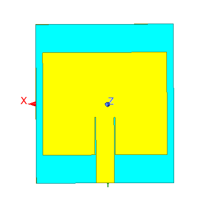<br>
  <em>HFSS model of the inset-fed patch antenna (top view)</em>
</p>

---

## Table of Contents

1. [Key Results](#1-key-results)
2. [Design Specifications](#2-design-specifications)
3. [Step-by-Step Design Procedure](#3-step-by-step-design-procedure)
4. [Results and Discussion](#4-results-and-discussion)
5. [Validation: Consistency Checks](#5-validation-consistency-checks)
6. [Comparison with Existing Work](#6-comparison-with-existing-work)
7. [Applications](#7-applications)
8. [Limitations and Future Work](#8-limitations-and-future-work)
9. [Notes on the Reported Values](#9-notes-on-the-reported-values)
10. [Repository Structure and How to Reproduce](#10-repository-structure-and-how-to-reproduce)
11. [References](#11-references)

---

## 1. Key Results

| Parameter (at 3.5 GHz) | Value |
|---|---|
| Minimum return loss (S11) | **−31.5 dB** |
| VSWR | **1.0545** (≈ 1.05) |
| Reflection coefficient \|Γ\| | 0.0265 |
| Input impedance | **52.65 + j0.65 Ω** (\|Z11\| = 52.65 Ω) |
| −10 dB impedance bandwidth | **89.6 MHz** (3.4519 – 3.5415 GHz), ≈ 2.56 % |
| Peak realised gain | **7.19 dB** (broadside) |
| Peak directivity | **7.13 dBi** (5.17 linear) |
| Radiation pattern | Single broadside lobe (dominant TM₀₁ mode) |
| Back-lobe minimum gain | ≈ −24.5 dB |
| Radiation efficiency | 99.85 % (0.9985) |

---

## 2. Design Specifications

| Parameter | Value |
|---|---|
| Resonant frequency `fr` | 3.5 GHz (5G NR n78) |
| Substrate | Rogers Ultralam 1217, εr = 2.17 |
| Substrate thickness `h` | 1.58 mm |
| Conductor | Copper (patch, feed line and ground plane) |
| Feeding technique | Inset microstrip line feed |
| Target input impedance | 50 Ω |
| Target return loss | below −10 dB at the design frequency |
| Simulator | Ansys HFSS 2025 R2 (Student), driven-modal solution |

---

## 3. Step-by-Step Design Procedure

### Step 1 – Define the requirements

Fix the centre frequency (3.5 GHz, inside the n78 band), the 50 Ω input impedance and the acceptance criterion (S11 below −10 dB, i.e. VSWR < 2, at the design frequency). These are the targets listed in [Section 2](#2-design-specifications).

### Step 2 – Select the substrate

Rogers Ultralam 1217 (εr = 2.17, h = 1.58 mm) was chosen instead of FR-4 (εr ≈ 4.3 – 4.4):

| Reason | Effect |
|---|---|
| Low permittivity | Less fringing-field confinement, so more energy couples to free space – higher radiation efficiency and bandwidth |
| Low loss tangent | Lower dielectric loss, giving near-unity radiation efficiency in simulation |
| 1.58 mm standard laminate thickness | Sufficient bandwidth without excessive surface-wave loss |

The trade-off is a higher material cost than FR-4.

### Step 3 – Calculate the patch dimensions

The initial dimensions come from the standard transmission-line model:

| Quantity | Equation | Calculated |
|---|---|---|
| Patch width | $W = \dfrac{c}{2f_r}\sqrt{\dfrac{2}{\varepsilon_r+1}}$ | 34.04 mm |
| Effective permittivity | $\varepsilon_{reff} = \dfrac{\varepsilon_r+1}{2} + \dfrac{\varepsilon_r-1}{2}\left(1+\dfrac{12h}{W}\right)^{-1/2}$ | 2.05 |
| Fringing length extension | $\Delta L = 0.412\,h\,\dfrac{(\varepsilon_{reff}+0.3)\left(\frac{W}{h}+0.264\right)}{(\varepsilon_{reff}-0.258)\left(\frac{W}{h}+0.8\right)}$ | 0.83 mm |
| Effective length | $L_{eff} = \dfrac{c}{2f_r\sqrt{\varepsilon_{reff}}}$ | 29.90 mm |
| Patch length | $L = L_{eff} - 2\Delta L$ | 28.24 mm |

### Step 4 – Size the ground plane

The ground plane is extended by about six times the substrate thickness beyond the patch edges to reduce truncation effects on the current distribution:

$$L_g = L + 6h, \qquad W_g = W + 6h$$

This gives about 37.7 mm (patch-length direction) and 43.5 mm (patch-width direction). The final ground-plane dimensions used in HFSS are 43.54 mm and 37.736 mm (Table I).

### Step 5 – Set the 50 Ω feed-line width

The feed-line width `Wf` is chosen so that the microstrip line presents 50 Ω on this substrate. For εr = 2.17 and h = 1.58 mm this requires w/h ≈ 3.13, i.e. **Wf ≈ 4.95 mm** (4.951 mm in the model, consistent with the standard Hammerstad synthesis formula).

### Step 6 – Design the inset feed

An inset feed is used instead of a simple edge feed or a quarter-wave transformer. Recessing the feed line into the patch moves the feed point to where the cavity-mode input resistance equals 50 Ω:

$$R_{in}(y_0) = R_{edge}\cos^2\!\left(\frac{\pi y_0}{L}\right)$$

where `y0` is the inset depth (`Li` in the model) and `Redge` is the patch edge (radiation) resistance.

| Inset parameter | Value |
|---|---|
| Inset (notch) length `Li` | 10.3 mm |
| Inset (notch) width `Wi` | 0.3 mm |

With `Li` = 10.3 mm and `L` = 28.1 mm, cos²(π·Li/L) ≈ 0.166, which corresponds to an edge resistance of ≈ 300 Ω – a typical value for a rectangular patch. The inset depth was then fine-tuned in HFSS (Step 9).

**Advantages of this feed:** no extra board area or insertion loss from a separate matching network, and direct control of the impedance match through the inset depth alone.

### Step 7 – Build the model in HFSS

Create the stack-up (patch, feed line and ground plane as copper on the Rogers Ultralam 1217 dielectric) using the final optimised dimensions:

**Table I – Final optimised dimensions (HFSS design variables)**

| Parameter | Symbol | Value (mm) |
|---|---|---|
| Patch width | `Wp` | 34.06 |
| Patch length | `Lp` | 28.1 |
| Substrate thickness | `h` | 1.58 |
| Ground plane length | `Lg` | 43.54 |
| Ground plane width | `Wg` | 37.736 |
| Feed line length | `Lf` | 21.77 |
| Feed line width | `Wf` | 4.951 |
| Inset notch length | `Li` | 10.3 |
| Inset notch width | `Wi` | 0.3 |

**Analytical vs. final values**

| Parameter | Analytical | Final (HFSS) |
|---|---|---|
| Patch width | 34.04 mm | 34.06 mm |
| Patch length | 28.24 mm | 28.1 mm |
| 50 Ω feed width | 4.95 mm | 4.951 mm |

### Step 8 – Define the excitation, boundaries and solution setup

| Setting | Value |
|---|---|
| Solution type | Driven modal |
| Conductors | Copper (perfect-conductor sheets) on the Ultralam 1217 dielectric |
| Excitation | Wave port at the feed-line edge |
| Radiation box | Vacuum air box terminated with a radiation boundary |
| Mesh | Adaptive tetrahedral mesh |
| Solution frequency | 3.5 GHz |
| Frequency sweep | Interpolating sweep, 2 – 5 GHz |
| Far-field data | Gain, directivity and radiation efficiency at 3.5 GHz (`LastAdaptive` solution) |

### Step 9 – Optimise with parametric sweeps

Start from the analytical dimensions and run parametric sweeps in HFSS, mainly of the inset length `Li` and notch width `Wi` (and the patch dimensions), until the S11 minimum sits at 3.5 GHz with the best depth. The final values are those of Table I; the S11 dip of −31.5 dB shows that `Li` and `Wi` are tuned close to their optimum.

### Step 10 – Run the simulation and extract the results

Plot and record, in this order: S11, VSWR, input impedance (Z11), bandwidth, gain, directivity, radiation pattern, radiation efficiency, Smith chart, and the E-field, H-field and surface-current distributions. They are presented in [Section 4](#4-results-and-discussion).

### Step 11 – Validate the results

Cross-check the results against each other (S11 ↔ VSWR ↔ Z11 ↔ Smith chart, gain ↔ directivity). See [Section 5](#5-validation-consistency-checks).

### Step 12 – Benchmark against the literature

Compare with other 3.5 GHz / n78 patch antennas ([Section 6](#6-comparison-with-existing-work)).

---

## 4. Results and Discussion

### 4.1 Return loss (S11)

<p align="center">
  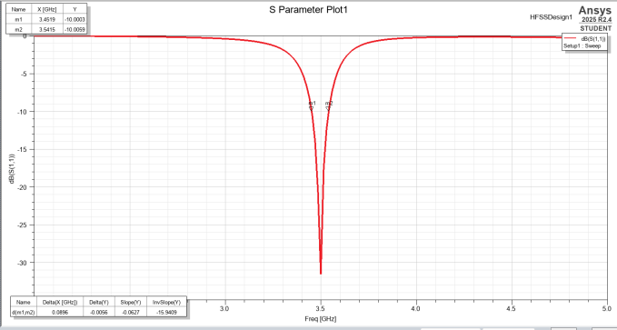<br>
  <em>S11 over the 2 – 5 GHz sweep – a single sharp resonance at 3.5 GHz with a minimum of ≈ −31.5 dB</em>
</p>

The markers give a −10 dB band from **3.4519 GHz to 3.5415 GHz**, i.e. a bandwidth of **0.0896 GHz (≈ 89.6 MHz, 2.56 %)**. This covers a sub-slice of the n78 band around 3.5 GHz, not the full 3.3 – 3.8 GHz allocation.

### 4.2 VSWR

<p align="center">
  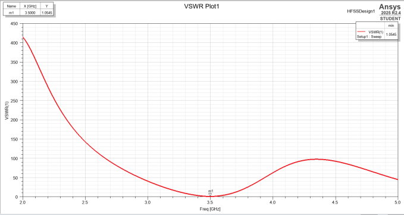<br>
  <em>VSWR versus frequency – minimum 1.0545 at 3.5 GHz</em>
</p>

The VSWR of 1.0545 is far below the VSWR < 2 criterion and close to the ideal value of 1. It rises sharply away from resonance, as expected for a narrowband resonant structure, with a broad hump near 4.3 – 4.5 GHz that is an out-of-band mismatch region, not an operating point.

### 4.3 Input impedance (Z-parameter)

<p align="center">
  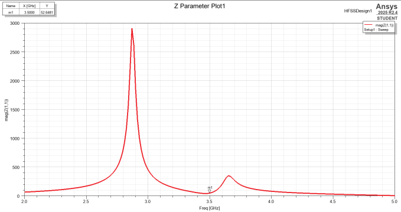<br>
  <em>|Z11| versus frequency – 52.65 Ω at 3.5 GHz</em>
</p>

At 3.5 GHz, |Z11| = 52.65 Ω, very close to the 50 Ω target. Two further impedance peaks appear – near 2.87 GHz (≈ 2900 Ω) and near 3.65 GHz (≈ 350 Ω). They are higher-order cavity / feed-line resonances outside the operating band and do not affect performance at 3.5 GHz.

### 4.4 Gain

<p align="center">
  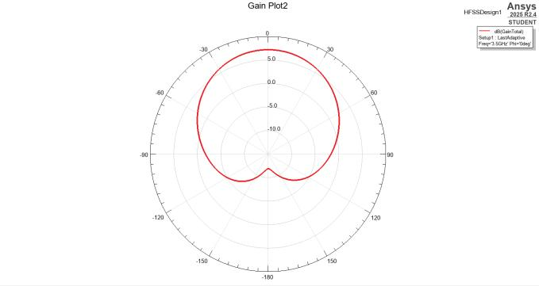
  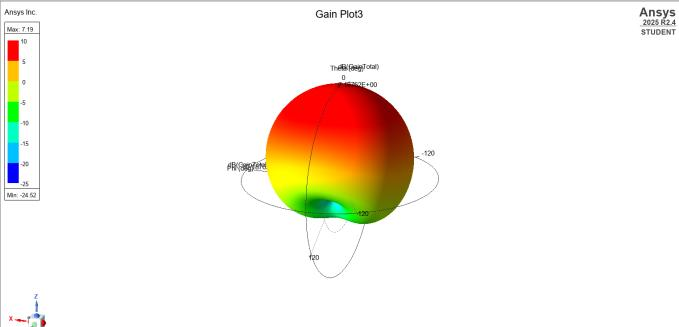<br>
  <em>2-D gain pattern (φ = 0°) and 3-D gain pattern at 3.5 GHz – peak 7.19 dB at broadside</em>
</p>

The peak realised gain is **7.19 dB** at broadside (θ ≈ 0°). The gain falls smoothly towards the horizon (θ = ±90°) and drops to a minimum of ≈ −24.5 dB in the back-lobe region behind the finite ground plane.

### 4.5 Directivity

<p align="center">
  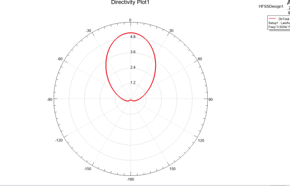
  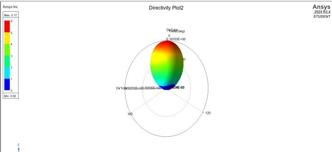<br>
  <em>2-D (linear scale) and 3-D directivity at 3.5 GHz – peak 5.17 (≈ 7.13 dBi)</em>
</p>

### 4.6 Radiation pattern

Figures in Sections 4.4 and 4.5 show a **single broadside main lobe**, typical of the dominant TM₀₁ cavity mode, with a modest back-lobe caused by diffraction around the finite ground plane and residual currents on its underside. No grating lobes or pattern squint are observed, so the inset feed does not introduce noticeable pattern asymmetry.

### 4.7 Radiation efficiency

<p align="center">
  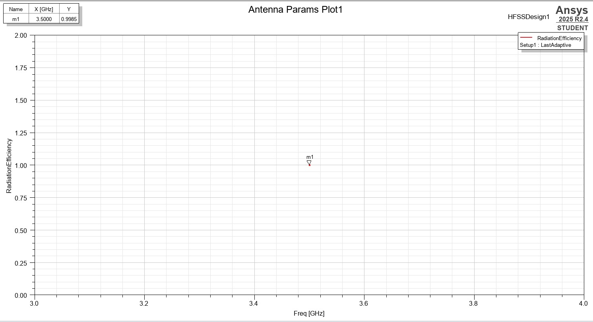<br>
  <em>Radiation efficiency at 3.5 GHz as reported by HFSS (0.9985, i.e. 99.85 %)</em></p>

### 4.8 Smith chart

<p align="center">
  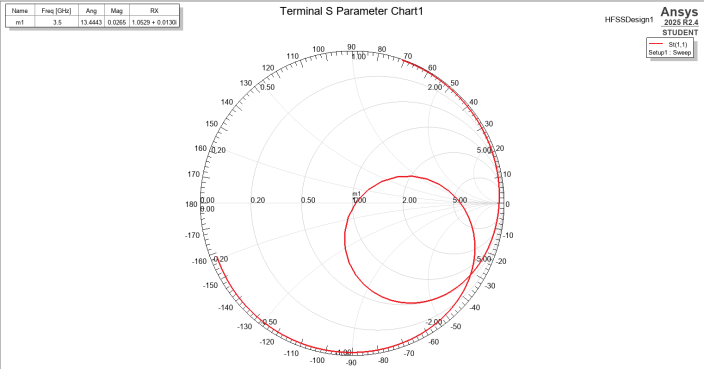<br>
  <em>Terminal S(1,1) on the Smith chart – marker m1 at 3.5 GHz close to the chart centre</em>
</p>

At 3.5 GHz the normalised impedance is z = 1.0529 + j0.0130 (|Γ| = 0.0265), i.e. **Z = 52.65 + j0.65 Ω** on the 50 Ω reference. The locus is a single, well-damped loop through the real axis near the 1.0 point, so the reactive part is essentially cancelled at resonance.

### 4.9 Field and current distributions

<p align="center">
  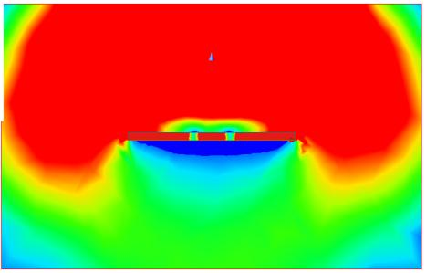
  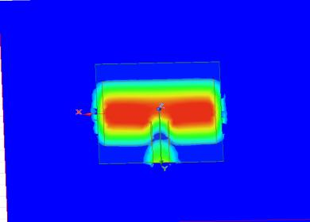
  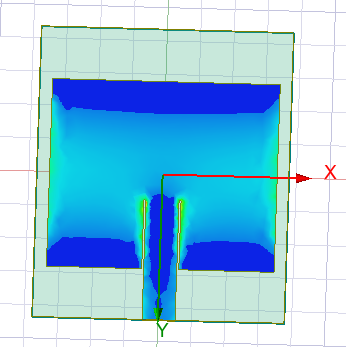<br>
  <em>E-field magnitude (XZ cross-section) · H-field magnitude (XY plane) · surface current density Jsurf (top view)</em>
</p>

| Distribution | Observation | What it confirms |
|---|---|---|
| **E-field (XZ-plane)** | Strongest above the patch and bulging outward past the two patch edges as fringing lobes; low field under the patch inside the substrate | The two edges act as radiating slots, as predicted by the cavity model |
| **H-field (XY-plane)** | Two symmetric high-intensity lobes either side of the feed axis, separated by a null along the centreline at the inset notch | Tangential H-field signature of the dominant TM₀₁₀ mode; the notch causes no asymmetry |
| **Surface current (Jsurf)** | Concentrated along the two non-radiating edges and around the inset notch; minimum along the radiating edges | Current maxima along the resonant length and minima at the open-circuited edges; the inset feed taps into a high-current region, which is why it matches to 50 Ω without a transformer |

---

## 5. Validation: Consistency Checks

| Check | Calculation | Result |
|---|---|---|
| S11 from reflection coefficient | 20·log₁₀(0.0265) | ≈ −31.5 dB  |
| VSWR from reflection coefficient | (1 + 0.0265) / (1 − 0.0265) | ≈ 1.054  |
| Impedance from Smith chart | 50 Ω × (1.0529 + j0.0130) | 52.65 + j0.65 Ω (matches \|Z11\| = 52.65 Ω) |
| Directivity, linear to dB | 10·log₁₀(5.17) | ≈ 7.13 dBi  |
| Bandwidth | 3.5415 − 3.4519 = 0.0896 GHz; 0.0896 / 3.5 | 89.6 MHz, 2.56 %  |
| Patch size vs analytical model | 34.06 / 28.1 mm vs 34.04 / 28.24 mm | agree within 0.5 %  |
| 50 Ω feed width | w/h ≈ 3.13 → 4.95 mm | matches 4.951 mm  |

---

## 6. Comparison with Existing Work

| Design | Substrate | Freq. (GHz) | Return loss (dB) | VSWR | Gain (dB) | −10 dB BW |
|---|---|---|---|---|---|---|
| **Proposed (this work)** | Rogers Ultralam 1217 (εr = 2.17) | 3.5 | ≈ −31.5 | 1.05 | 7.19 | ≈ 89.6 MHz |
| Cirik & Yildirim [2] | PCB laminate | 3.5 | – | – | – | Narrowband |
| Al-Gburi et al. [3] | PCB laminate (array) | 3.5 | – | – | Array > single | – |
| Dual-band DGS [4] | FR-4 (εr = 4.4, 1.6 mm) | 3.50 – 3.68 | ≈ −27.7 | – | – | ≈ 180 MHz |
| Proximity-coupled DGS [5] | FR-4 class | 3.5 | ≈ −17.4 | 1.31 | ≈ 6.6 | ≈ 65 MHz |
| Slot / parasitic dual-band [6] | FR-4 (εr = 4.3) | 3.45 | – | – | ≈ 3.83 | ≈ 160 MHz |

The proposed design achieves competitive gain and an excellent impedance match, at the cost of a narrower single-band bandwidth than designs that use bandwidth-enhancing structures. Substrates, fabrication tolerances and measurement conditions differ between the works, so the comparison should be read with caution.

---

## 7. Applications

- 5G New Radio user-equipment and small-cell base-station antennas in the n78 mid-band (3.3 – 3.8 GHz)
- Fixed wireless access (FWA) and point-to-point wireless backhaul around 3.5 GHz
- WiMAX (IEEE 802.16) terminals in the 3.5 GHz band
- IoT gateways and customer-premises equipment (CPE) needing a low-profile, low-cost printed antenna
- Building block for linear or phased arrays for sectorised 5G coverage

---

## 8. Limitations and Future Work

**Limitations**
- The −10 dB bandwidth (≈ 89.6 MHz, 2.56 %) does not cover the full 500 MHz n78 allocation.
- Results are simulation-only; the antenna has not been fabricated or measured.

**Future work**
1. Widen the bandwidth to the full 3.3 – 3.8 GHz band with a defected ground structure, parasitic patches, stacked patches, or a thicker / lower-permittivity substrate.
2. Fabricate the antenna and compare measured and simulated results, including connector and cable losses.
3. Use the element in a linear / planar array for higher gain.

---

## 9. Notes on the Reported Values

- **Radiation efficiency:** 99.85 % (0.9985) at 3.5 GHz, close to unity as expected for a low-loss substrate.
- **Gain vs directivity:** the peak gain (7.19 dB) is about 0.06 dB above the directivity (7.13 dBi). This small difference is within HFSS numerical tolerance; with a radiation efficiency of 99.85 % the two values are expected to be nearly equal.
- **Secondary impedance peaks** near 2.87 GHz and 3.65 GHz lie outside the band but should be kept in mind if the antenna is integrated into a multi-band or wideband system.

---

## 10. Repository Structure and How to Reproduce

```
3.5GHz-Inset-Fed-Patch-Antenna-5G-n78/
│
├── README.md                    # Project documentation (this file)
└── images/
    ├── design/                  # HFSS model (top view)
    ├── results/                 # S11, VSWR, Z11, gain, directivity, efficiency, Smith chart
    └── field_distributions/     # E-field, H-field and surface-current plots
```

**To reproduce in HFSS**

1. Insert a new *Driven Modal* design in Ansys HFSS (2025 R2 Student was used).
2. Define the variables of Table I ([Step 7](#step-7--build-the-model-in-hfss)).
3. Create the Rogers Ultralam 1217 substrate (εr = 2.17, h = 1.58 mm), the ground plane, the patch with the inset notch (`Li`, `Wi`) and the 50 Ω feed line (`Wf`, `Lf`) as copper.
4. Assign a wave port at the feed-line edge and enclose the model in a vacuum air box with a radiation boundary.
5. Set the adaptive solution at 3.5 GHz and an interpolating sweep from 2 to 5 GHz.
6. Run parametric sweeps of `Li` and `Wi` to centre the S11 minimum at 3.5 GHz.
7. Create the far-field setup and plot gain, directivity and radiation efficiency at 3.5 GHz.


---

## 11. References

1. C. A. Balanis, *Antenna Theory: Analysis and Design*, 4th ed. Hoboken, NJ, USA: Wiley, 2016.
2. F. Cirik and B. S. Yildirim, "Analysis and design of a 3.5-GHz patch antenna for WiMAX applications," 2016.
3. A. J. A. Al-Gburi, Z. Zakaria, I. M. Ibrahim and E. B. A. Halim, "Microstrip patch antenna arrays design for 5G wireless backhaul application at 3.5 GHz," in *Lecture Notes in Electrical Engineering*, vol. 865, Singapore: Springer, 2022, pp. 77–88.
4. "Dual-band patch antenna for 5G NR (n48, n46, n77, n78), Wi-Fi, and indoor wireless applications," *Scientific Reports*, Nature Publishing Group, 2026.
5. "3.5 GHz rectangular patch microstrip antenna with defected ground structure for 5G," ResearchGate preprint, 2020.
6. "A patch antenna with enhanced gain and bandwidth for sub-6 GHz and sub-7 GHz 5G wireless applications," *Electronics*, vol. 12, no. 12, Art. 2555, 2023.
7. M. S. Rana *et al.*, "An S-band microstrip patch antenna design and simulation for wireless communication systems," *Indonesian J. Electr. Eng. Informat.*, vol. 10, pp. 945–954, 2022.
8. "Analysis and design of 3.5 GHz patch antenna for 5G wireless network applications," Springer Nature Link, book chapter, 2025.

---

## Citation

Shanmugavalli P, "Design and Performance Analysis of a 3.5 GHz Inset-Fed Rectangular Microstrip Patch Antenna for 5G n78-Band Applications Using HFSS," Department of Electronics and Communication Engineering, College of Engineering Guindy, Anna University.
